
<b>English</b> · <a href="README.pt-BR.md">Português (Brasil)</a>

  

<h1 align="center">Save Editor Paradise</h1>

  <b>Edit your game saves right on your Nintendo Switch.</b> 
  No PC, no copying files back and forth: pick a game, pick a save, change what you want.

  
  
  
  
  

  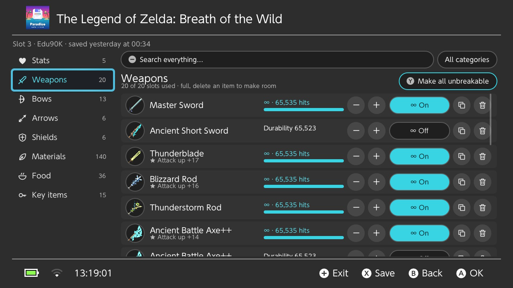
   Real screenshots, taken on a Switch.

---

## Contents

- [What it can do](#what-it-can-do)
- [Supported games](#supported-games)
- [Shrine Tracker (Zelda)](#shrine-tracker-zelda)
- [Edit from your phone or PC](#edit-from-your-phone-or-pc)
- [Screenshots](#screenshots)
- [Install](#install)
- [Updating](#updating)
- [How to use it](#how-to-use-it)
- [Games without a built-in editor](#games-without-a-built-in-editor)
- [Backups and restoring](#backups-and-restoring)
- [Real game icons (Zelda)](#real-game-icons-zelda)
- [Safety](#safety)
- [FAQ](#faq)
- [Bugs, ideas and game requests](#bugs-ideas-and-game-requests)
- [Support the project](#support-the-project)
- [Credits](#credits)

## What it can do

- **Every game with a save, in one place.** Your games are listed with their icons, sorted by last played, last saved or name, and searchable.
- **Every profile and every slot.** Slots show their save date and time, play time, a short summary (hearts, rupees, money…), the game's own screenshot when it has one, and whether it's an autosave or a manual save (Zelda).
- **Built-in editors** for popular games: money, items, stats, unlocks, and for Zelda, unbreakable weapons, bows and shields, plus a full **[Shrine Tracker](#shrine-tracker-zelda)**.
- **[Edit from your phone or PC](#edit-from-your-phone-or-pc)** in a browser on the same Wi-Fi: download and upload saves, restore backups, edit values with a real keyboard.
- **Review before saving:** every change is listed (old → new) before anything is written, and each slot keeps a **history** of its changes.
- **Copy and swap** slots, or copy a whole save to another profile.
- **Favourites** at the top of your games, and a filter for games with an editor.
- **Type any value** with the number keyboard, or use − / + / Max and **Max all**.
- **Search** inside a save (one category or all of them), and long lists are split into pages.
- **Automatic backups** before every save you edit, plus manual backups with a label, **back up all games** at once, and your **JKSV backups**. Any backup can be restored, and restoring can be undone.
- **Find a value** for games without an editor: search for a number you can see in the game and turn it into an editable field, or download the fields other players shared.
- **In-app updates** from this page, with the release notes shown on the console.
- **Fully translated into English and Português (Brasil).** The app follows your console's language, or you can pick one in Settings.

## Supported games

Built-in editors for **Zelda** (Breath of the Wild, Tears of the Kingdom, Age of Calamity), **Pokémon** (Scarlet/Violet, Sword/Shield, Legends: Arceus, Let's Go), **Mario** (Odyssey, Wonder, Mario Kart 8 Deluxe), **Donkey Kong Country: Tropical Freeze**, **Smash Bros. Ultimate** and **Super Kirby Clash**. Every other game gets backups and [Find a value](#games-without-a-built-in-editor).

📋 **[See every supported game and what you can edit →](GAMES.md)**

Want another game? See [game requests](#bugs-ideas-and-game-requests).

## Screenshots

| | |
| --- | --- |
| 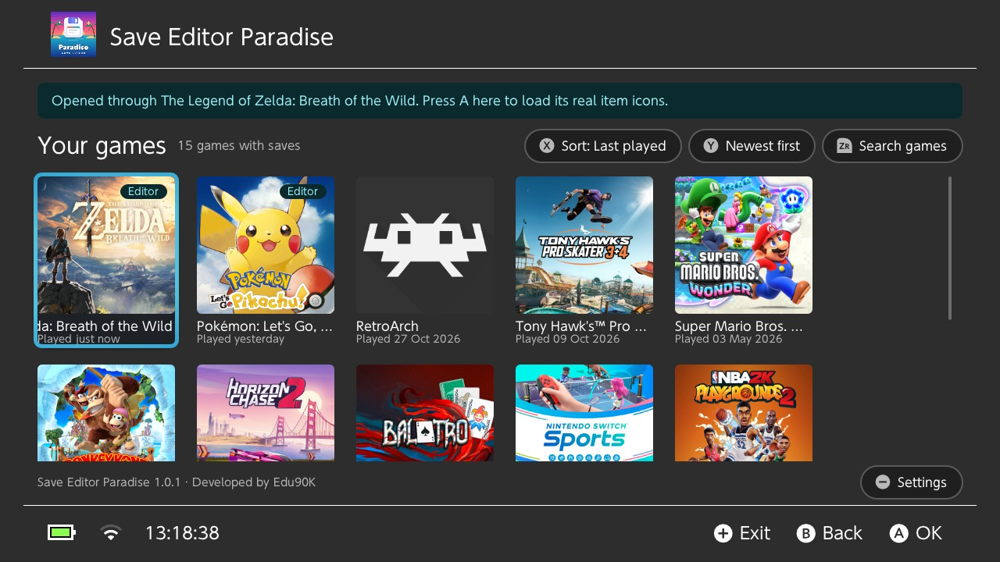 | 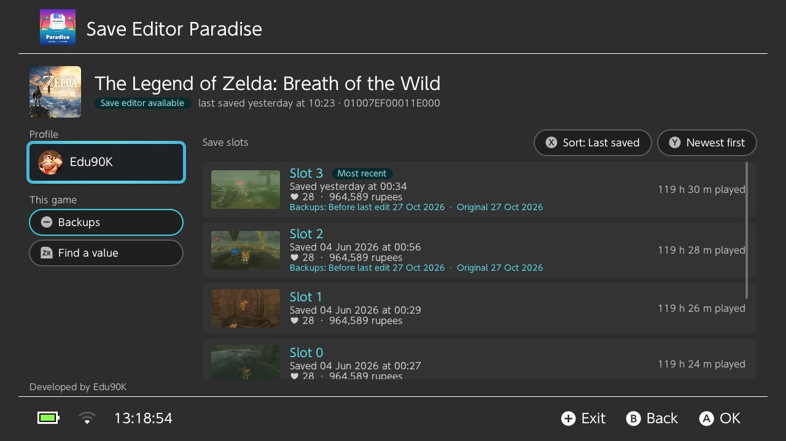 |
| Your games, with their real icons | Save slots with the game's own screenshots |
| 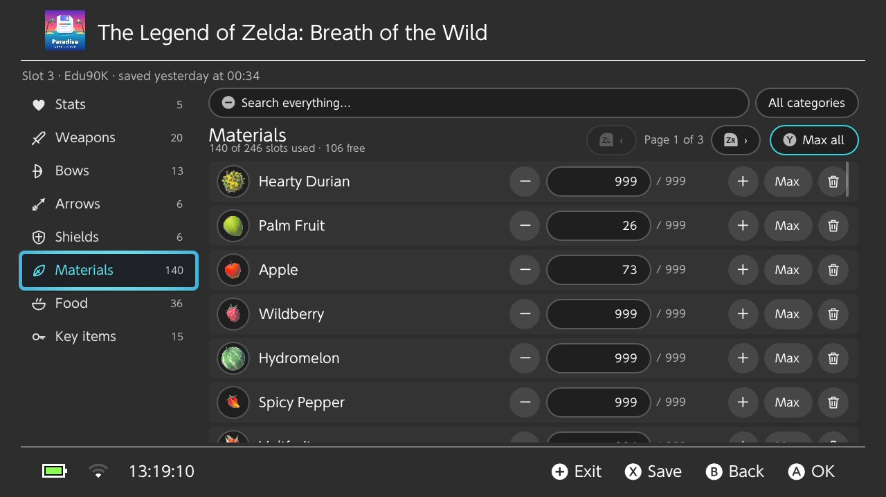 | 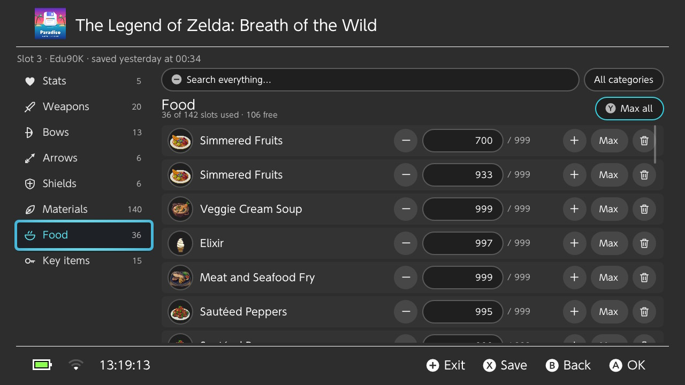 |
| Materials, with real item icons and pages | Food, with counts you can type |
| 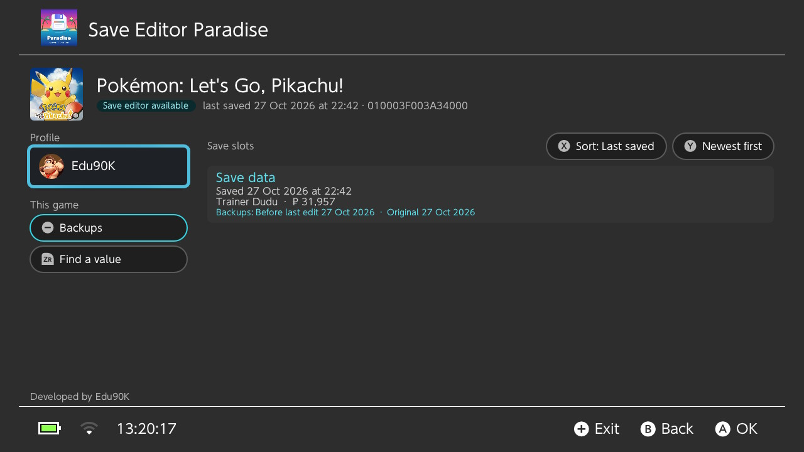 | 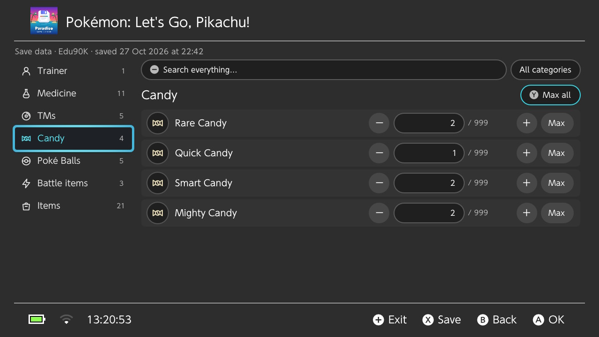 |
| Pokémon: Let's Go, Pikachu! save | Bag items with their names |

## Shrine Tracker (Zelda)

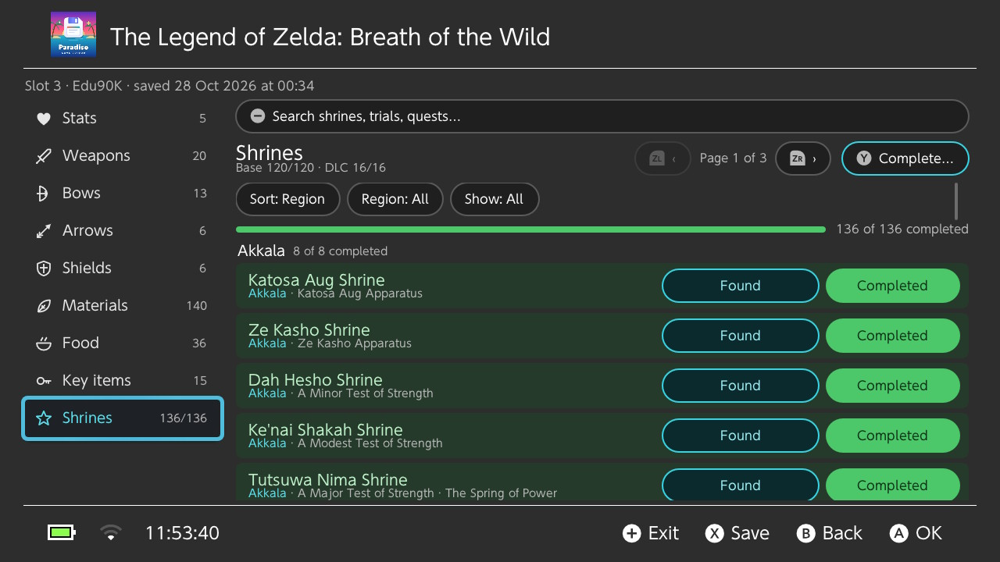

Breath of the Wild (136 shrines, 16 from the DLC) and Tears of the Kingdom (152 shrines, 32 in the sky) get a **Shrines** tab in the editor:

- Every shrine with its **trial, region and quest**, grouped by region with a completed count, and a progress bar.
- Each row has two buttons: **Found / Not found** and **Completed / Incomplete**. Move between them with **◀ ▶** and press **A**. Completing a shrine also marks it found. Completed shrines turn green.
- **Sort** by region, name, completed, found, base / DLC (sky in TotK) or game order, **filter** by region, and **show** only completed, incomplete, found, not found, base or DLC shrines. Search covers names, trials and quests.
- **Y → Complete…** completes all base shrines, all DLC (or sky) shrines, or all of them, marks all as found, or resets all to incomplete.
- As with every edit, you see the changes before saving and the slot is backed up first.

In Tears of the Kingdom a shrine the save has already found can't be set back to "not found": the game's value for an undiscovered shrine isn't known. DLC shrines only appear in Breath of the Wild saves that have the DLC's data.

## Edit from your phone or PC

  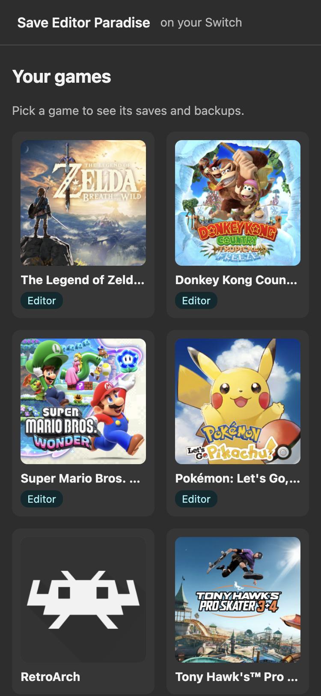
  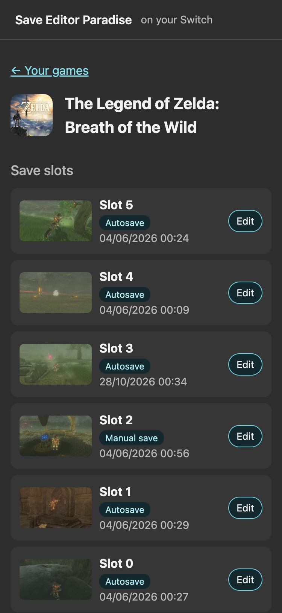

Open **Settings → Edit from your phone or PC**. The Switch shows a QR code and an address:

1. Connect your phone or computer to the **same Wi-Fi** as the Switch.
2. Scan the QR code or type the address in a browser.
3. Keep that screen open on the Switch while you use it. Leaving it turns the page off.

In the browser you can see your games (with their real icons) and each slot's screenshot, **edit values** with a real keyboard, **download** any backup as a .zip, **back up** a save, **upload** a save (a .zip from this page or from JKSV, or a single file), and **restore** backups. Everything works like on the console: edits are backed up first and show up in the slot's history, and nothing is written while the game is running.

Only devices with the code from the QR can open the page (it changes every time), and only while the screen is open on the Switch.

## Install

**You need** a Nintendo Switch running [Atmosphère](https://github.com/Atmosphere-NX/Atmosphere) custom firmware with the Homebrew Menu.

1. Download **`save-editor-paradise.nro`** from the [latest release](https://github.com/eduardo-santos/switch-save-editor-paradise-releases/releases/latest).
2. Copy it to the **`/switch/`** folder of your SD card.
3. Open the Homebrew Menu and start **Save Editor Paradise**.

> **Tip:** open the Homebrew Menu by holding **R** while starting any game (not from the Album). The app then has all the console's memory, which large saves and the real-icon loader like.

## Updating

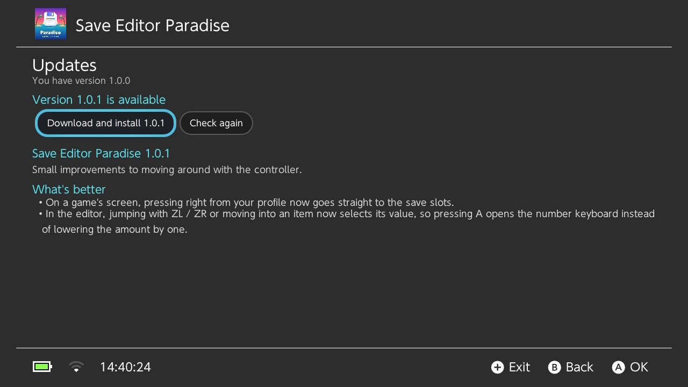

Open **Settings → Check for updates now** in the app. It shows what's new, downloads the update, checks it and restarts into the new version. The previous version is kept as `/switch/save-editor-paradise/previous.nro`, just in case.

With **Check for updates when the app opens** turned on (the default), the app tells you when a new version is out. You can also just replace the `.nro` on your SD card by hand.

Some updates are **mandatory** (their release name says so), for example when an older version could damage saves. When one is out, the app asks you to install it before you can keep using it. Your saves, backups and settings are kept.

## How to use it

### 1. Pick a game

Games with a built-in editor have an **Editor** badge. Sort with **X**, flip the order with **Y**, search with **ZR**. **R** makes a game a favourite (pinned to the top) and **L** shows all games, only games with an editor, or favourites. **−** opens Settings.

### 2. Pick a profile and a slot

Each slot shows when it was saved, the play time and a short summary. **R** on a slot opens its **history**, and lets you **copy** it over another slot or **swap** two slots. The **Backups**, **Find a value** and **Copy to profile** buttons apply to the whole game. Anything replaced is backed up first.

> **Close the game first.** A running game keeps its save locked and would overwrite your changes. The app tells you when a game is still open.

### 3. Edit

  
  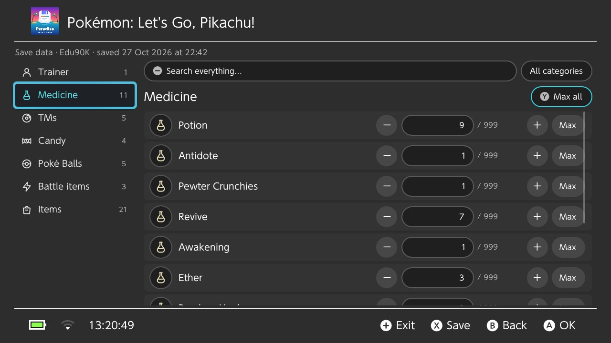

| Button | Does |
| --- | --- |
| **L / R** | Previous / next category |
| **A** | Change the selected value (type it, or use − / + / Max) |
| **Y** | Max all (or make all unbreakable, or unlock all) |
| **ZL / ZR** | Jump to the first / last item; press again for the previous / next page |
| **−** | Search |
| **X** | Review your changes and save |
| **B** | Back (asks before throwing away unsaved changes) |

Saving shows every change (old → new) first. When you confirm, the app backs up the slot, writes your changes and adds them to the slot's history.

> **Breath of the Wild:** after editing, load the slot with **Load** in the game's menu. **Continue** may pick a different slot.

## Games without a built-in editor

### Find a value

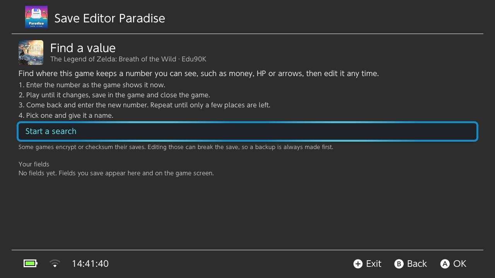

1. On the game's screen, choose **Find a value** (or press **ZR**).
2. Enter a number you can see in the game right now, such as your money.
3. Play until that number changes, save in the game and close it.
4. Come back and enter the new number. Repeat until only a few places are left.
5. Pick one, give it a name (and a maximum), and it becomes an editable field on that game's screen from then on.

**Shared fields:** choose **Get shared fields for this game** to download fields other players found. Found a useful one? [Share it](https://github.com/eduardo-santos/switch-save-editor-paradise-releases/issues/new?template=share_field.yml) (see [how shared fields work](fields/README.md)).

Some games encrypt or checksum their saves. Find a value can't change those safely, and the automatic backup lets you undo if a game refuses an edited save.

### Backup and restore

Every game can be backed up and restored, editor or not. See below.

## Backups and restoring

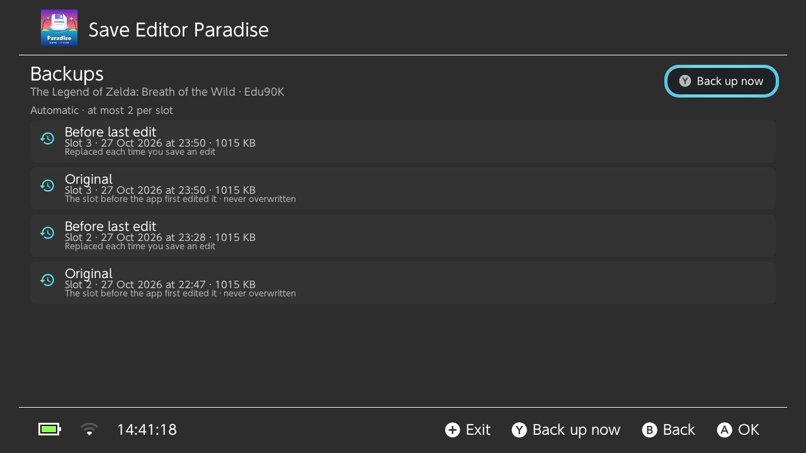

- **Automatic:** before every edit the app keeps at most two backups per slot: the **Original** (the slot the first time you edited it, kept forever) and **Before last edit** (replaced each time).
- **Manual:** make as many as you like, with a label, from the **Backups** screen (**−** on the game screen).
- **All games at once:** **Settings → Back up all games now**. Turn on **Back up when the app opens** to keep one extra backup of every game, refreshed in the background (only saves that changed are copied again).
- **JKSV:** backups made with JKSV show up in each game's list and can be restored too.
- **Restore** any of them from the same screen. Restoring first backs up the current state, so a restore can be undone too.

Everything lives in `/switch/save-editor-paradise/backups/` on your SD card.

## Real game icons (Zelda)

For **Breath of the Wild** and **Tears of the Kingdom**, the app can show the game's own item icons instead of its drawings. They're read from your own copy of the game, once:

1. Close the app and the game.
2. On the HOME screen, **hold R** and start the game. Keep holding until the Homebrew Menu opens.
3. Open Save Editor Paradise. A banner says it was opened through the game: press **A** on it.
4. Wait a minute or two, then close the app.

The icons are saved on the SD card, so this is needed only once per game. The app also explains this from the game screen (**Get real icons**).

## Safety

- **Use emuMMC and stay offline.** Edited saves combined with online play or cloud saves are a ban risk.
- **Every edit is backed up first**, and any backup can be restored.
- The app never writes to a save while its game is running.
- Pokémon: only money and item counts are edited; your Pokémon are never touched.

## FAQ

**My Breath of the Wild edit didn't show up.** Load the edited slot with **Load** instead of **Continue**.

**Is "unbreakable" really infinite?** It sets the highest durability the game accepts (Breath of the Wild) or the game's own durability bonus trick (Tears of the Kingdom). In practice your weapons don't break, but items you pick up later are normal until you edit them too.

**The app crashed.** Open **Settings → Diagnostic report** (or press **ZL** on the games screen) and add a photo of it to a [bug report](https://github.com/eduardo-santos/switch-save-editor-paradise-releases/issues/new?template=bug_report.yml). It includes the latest crash details and no save contents.

**Where is my data?** In `/switch/save-editor-paradise/` on the SD card: settings, backups, icons and Find a value fields. Data from older versions (`/switch/switch-save-editor/`) is moved there automatically.

**How do I change the language?** **Settings → Language**: System, English or Português (Brasil). Restart the app to apply it.

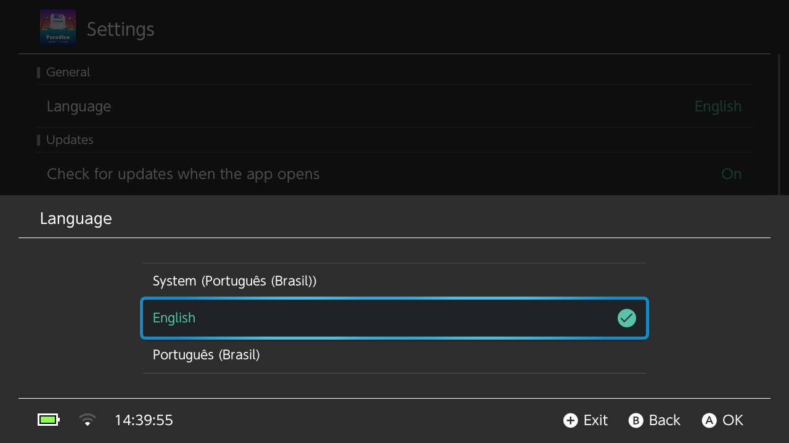

## Bugs, ideas and game requests

- 🐞 **Found a bug?** [Report it](https://github.com/eduardo-santos/switch-save-editor-paradise-releases/issues/new?template=bug_report.yml), ideally with a photo of the diagnostic report.
- 💡 **Have an idea or an improvement?** [Suggest it](https://github.com/eduardo-santos/switch-save-editor-paradise-releases/issues/new?template=idea.yml), or start a conversation in [Discussions](https://github.com/eduardo-santos/switch-save-editor-paradise-releases/discussions).
- 🎮 **Want another game supported?** [Request it](https://github.com/eduardo-santos/switch-save-editor-paradise-releases/issues/new?template=game_request.yml).

## Support the project

Save Editor Paradise is free. If it saved you hours of grinding, you can buy me a coffee:

## Credits

Developed by **Edu90K**.

Save Editor Paradise stands on the work of others:

- [Borealis](https://github.com/xfangfang/borealis) for the Switch-style interface
- [marcrobledo/savegame-editors](https://github.com/marcrobledo/savegame-editors) for the Zelda, Smash, Age of Calamity and Kirby save layouts
- [PKHeX](https://github.com/kwsch/PKHeX) (format documentation) and [PokeAPI](https://pokeapi.co) (item names) for Pokémon
- The [EdiZon](https://github.com/WerWolv/EdiZon_CheatsConfigsAndScripts) save research for Mario Kart 8 Deluxe, Super Mario Odyssey and Donkey Kong Country: Tropical Freeze
- [Kinnay/DKCTF-Save-Exploit](https://github.com/Kinnay/DKCTF-Save-Exploit) for the Tropical Freeze save layout
- The Super Mario Bros. Wonder save research in [smbw_ap](https://github.com/mdietz94/smbw_ap) and [SMBW-SaveGame-Editor](https://github.com/MemetendoYT/SMBW-SaveGame-Editor)
- [Zstandard](https://github.com/facebook/zstd), [ARM astc-encoder](https://github.com/ARM-software/astc-encoder) and [bcdec](https://github.com/iOrange/bcdec) for reading game icons

See [THIRD_PARTY_NOTICES.md](THIRD_PARTY_NOTICES.md) for licences.

Not affiliated with or endorsed by Nintendo, The Pokémon Company or any game publisher. All game names and trademarks belong to their owners.
