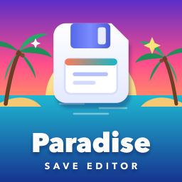
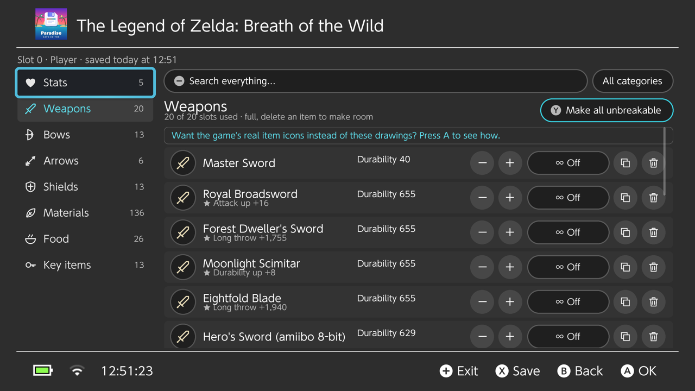
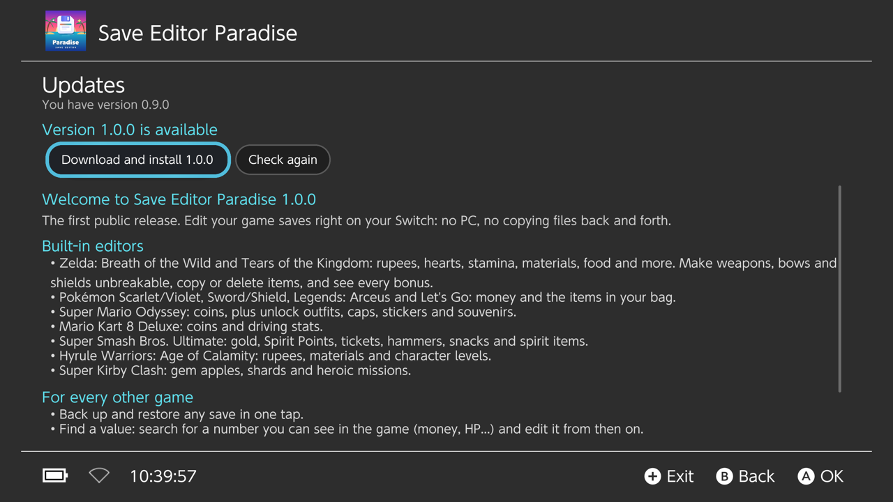
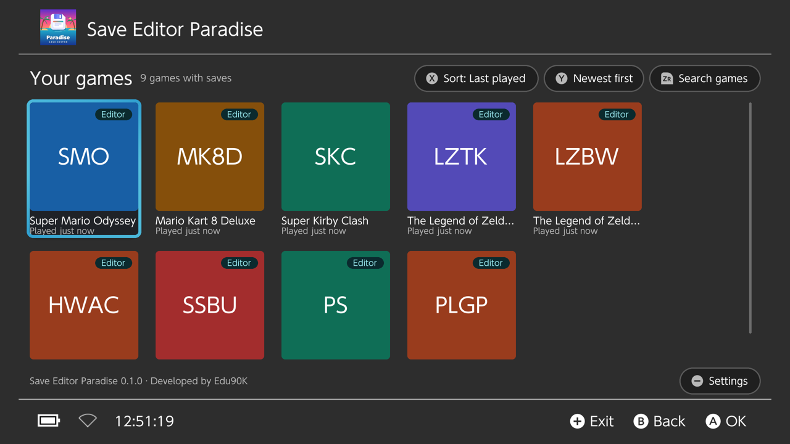
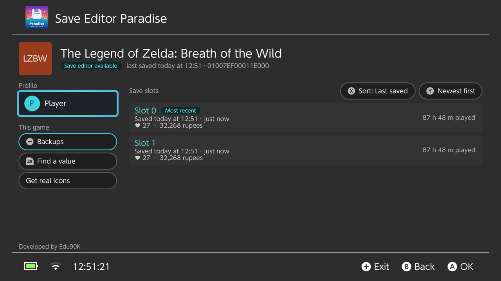
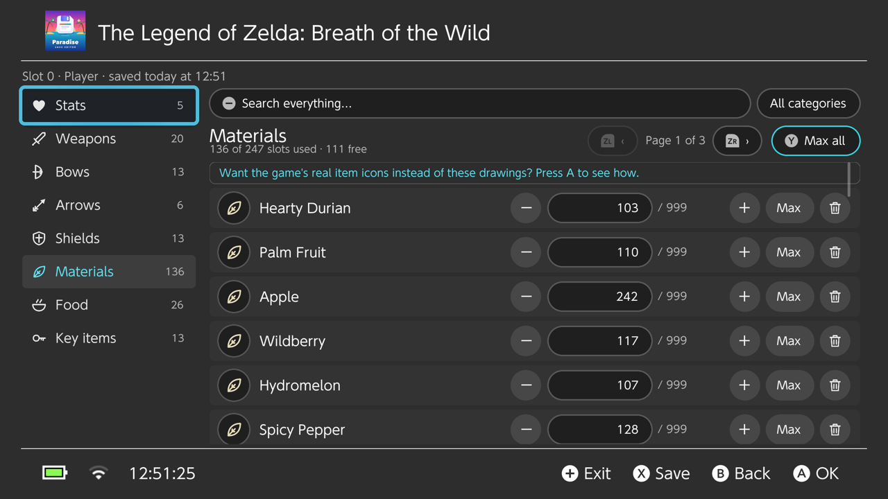
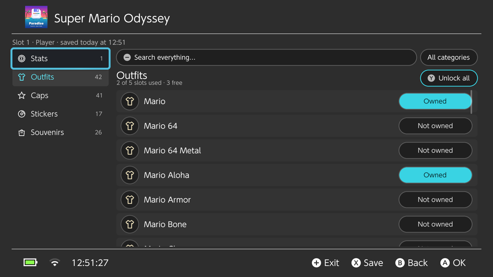
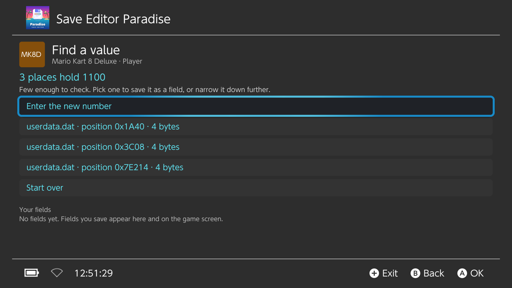
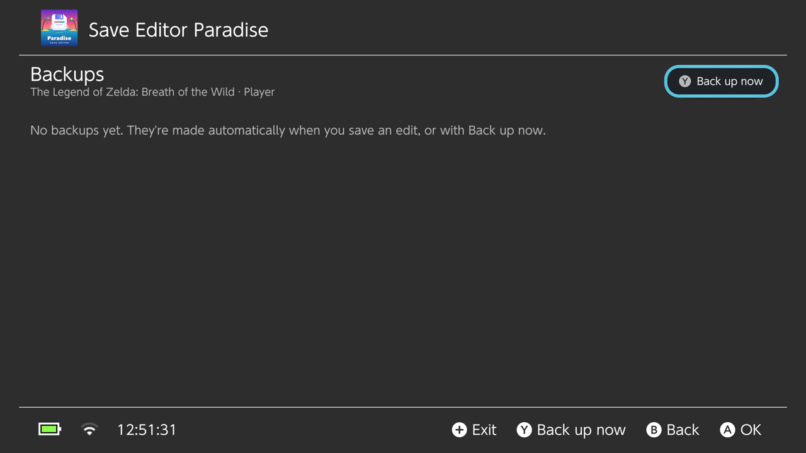

  

<h1 align="center">Save Editor Paradise</h1>

  <b>Edit your game saves right on your Nintendo Switch.</b> 
  No PC, no copying files back and forth: pick a game, pick a save, change what you want.

  
  
  
  

  

---

## Contents

- [What it can do](#what-it-can-do)
- [Supported games](#supported-games)
- [Install](#install)
- [Updating](#updating)
- [How to use it](#how-to-use-it)
- [Games without a built-in editor](#games-without-a-built-in-editor)
- [Backups and restoring](#backups-and-restoring)
- [Real game icons (Zelda)](#real-game-icons-zelda)
- [Safety](#safety)
- [FAQ](#faq)
- [Bugs, ideas and game requests](#bugs-ideas-and-game-requests)
- [Credits](#credits)

## What it can do

- **Every game with a save, in one place.** Your games are listed with their icons, sorted by last played, last saved or name, and searchable.
- **Every profile and every slot.** Slots show their save date and time, play time, a short summary (hearts, rupees, money…) and the game's own screenshot when it has one.
- **Built-in editors** for popular games: money, items, stats, unlocks, and for Zelda, unbreakable weapons, bows and shields.
- **Type any value** with the number keyboard, or use − / + / Max and **Max all**.
- **Search** inside a save (one category or all of them), and long lists are split into pages.
- **Automatic backups** before every save you edit, plus manual backups with a label. Any backup can be restored, and restoring can be undone.
- **Find a value** for games without an editor: search for a number you can see in the game and turn it into an editable field.
- **In-app updates** from this page, with the release notes shown on the console.
- **English and Português (Brasil)**, following your console's language or set manually.

## Supported games

| Game | What you can edit |
| --- | --- |
| **The Legend of Zelda: Breath of the Wild** | Rupees, hearts, stamina, Mons, Korok seeds, materials, food, arrows, key items; weapons, bows and shields with **unbreakable** (∞) per item or for all, copy and delete, free-slot counts and bonuses shown |
| **The Legend of Zelda: Tears of the Kingdom** | Rupees, hearts, stamina, battery, materials, food, Zonai devices, key items; weapons, bows and shields with **unbreakable** (∞), copy and delete, bonuses and food effects shown |
| **Pokémon Scarlet / Violet** | Money and the items in your bag |
| **Pokémon Sword / Shield** | Money and the items in your bag |
| **Pokémon Legends: Arceus** | Money and the items in your satchel, storage, key items and recipes |
| **Pokémon: Let's Go, Pikachu! / Eevee!** | Money and the items in your bag, with names |
| **Super Mario Odyssey** | Coins; unlock outfits, caps, stickers and souvenirs |
| **Mario Kart 8 Deluxe** | Coins, drifts, jump boosts and mini-turbo stats (online ratings are left alone) |
| **Super Smash Bros. Ultimate** | Gold, Spirit Points, tickets, hammers, snacks and spirit-battle items |
| **Hyrule Warriors: Age of Calamity** | Rupees, 160+ materials and the level of every character |
| **Super Kirby Clash** | Gem apples, shards, and the two hidden heroic missions |
| **Any other game** | Backup and restore, plus [Find a value](#games-without-a-built-in-editor) |

Want another game? See [game requests](#bugs-ideas-and-game-requests).

## Install

**You need** a Nintendo Switch running [Atmosphère](https://github.com/Atmosphere-NX/Atmosphere) custom firmware with the Homebrew Menu.

1. Download **`save-editor-paradise.nro`** from the [latest release](https://github.com/eduardo-santos/switch-save-editor-paradise-releases/releases/latest).
2. Copy it to the **`/switch/`** folder of your SD card.
3. Open the Homebrew Menu and start **Save Editor Paradise**.

> **Tip:** open the Homebrew Menu by holding **R** while starting any game (not from the Album). The app then has all the console's memory, which large saves and the real-icon loader like.

## Updating

Open **Settings → Check for updates now** in the app. It shows what's new, downloads the update, checks it and restarts into the new version. The previous version is kept as `/switch/save-editor-paradise/previous.nro`, just in case.

With **Check for updates when the app opens** turned on (the default), the app tells you when a new version is out. You can also just replace the `.nro` on your SD card by hand.

Some updates are **mandatory** (their release name says so), for example when an older version could damage saves. When one is out, the app asks you to install it before you can keep using it. Your saves, backups and settings are kept.

## How to use it

### 1. Pick a game

Games with a built-in editor have an **Editor** badge. Sort with **X**, flip the order with **Y**, search with **ZR**. **−** opens Settings.

### 2. Pick a profile and a slot

Each slot shows when it was saved, the play time and a short summary. The **Backups** and **Find a value** buttons apply to the whole game.

> **Close the game first.** A running game keeps its save locked and would overwrite your changes. The app tells you when a game is still open.

### 3. Edit

  
  

| Button | Does |
| --- | --- |
| **L / R** | Previous / next category |
| **A** | Change the selected value (type it, or use − / + / Max) |
| **Y** | Max all (or make all unbreakable, or unlock all) |
| **ZL / ZR** | Jump to the first / last item; press again for the previous / next page |
| **−** | Search |
| **X** | Save |
| **B** | Back (asks before throwing away unsaved changes) |

When you save, the app backs up the slot first, writes your changes and tells you where the backup is.

> **Breath of the Wild:** after editing, load the slot with **Load** in the game's menu. **Continue** may pick a different slot.

## Games without a built-in editor

### Find a value

1. On the game's screen, choose **Find a value** (or press **ZR**).
2. Enter a number you can see in the game right now, such as your money.
3. Play until that number changes, save in the game and close it.
4. Come back and enter the new number. Repeat until only a few places are left.
5. Pick one, give it a name (and a maximum), and it becomes an editable field on that game's screen from then on.

Some games encrypt or checksum their saves. Find a value can't change those safely, and the automatic backup lets you undo if a game refuses an edited save.

### Backup and restore

Every game can be backed up and restored, editor or not. See below.

## Backups and restoring

- **Automatic:** before every edit the app keeps at most two backups per slot: the **Original** (the slot the first time you edited it, kept forever) and **Before last edit** (replaced each time).
- **Manual:** make as many as you like, with a label, from the **Backups** screen (**−** on the game screen).
- **Restore** any of them from the same screen. Restoring first backs up the current state, so a restore can be undone too.

Everything lives in `/switch/save-editor-paradise/backups/` on your SD card.

## Real game icons (Zelda)

For **Breath of the Wild** and **Tears of the Kingdom**, the app can show the game's own item icons instead of its drawings. They're read from your own copy of the game, once:

1. Close the app and the game.
2. On the HOME screen, **hold R** and start the game. Keep holding until the Homebrew Menu opens.
3. Open Save Editor Paradise. A banner says it was opened through the game: press **A** on it.
4. Wait a minute or two, then close the app.

The icons are saved on the SD card, so this is needed only once per game. The app also explains this from the game screen (**Get real icons**).

## Safety

- **Use emuMMC and stay offline.** Edited saves combined with online play or cloud saves are a ban risk.
- **Every edit is backed up first**, and any backup can be restored.
- The app never writes to a save while its game is running.
- Pokémon: only money and item counts are edited; your Pokémon are never touched.

## FAQ

**My Breath of the Wild edit didn't show up.** Load the edited slot with **Load** instead of **Continue**.

**Is "unbreakable" really infinite?** It sets the highest durability the game accepts (Breath of the Wild) or the game's own durability bonus trick (Tears of the Kingdom). In practice your weapons don't break, but items you pick up later are normal until you edit them too.

**The app crashed.** Open **Settings → Diagnostic report** (or press **ZL** on the games screen) and add a photo of it to a [bug report](https://github.com/eduardo-santos/switch-save-editor-paradise-releases/issues/new?template=bug_report.yml). It includes the latest crash details and no save contents.

**Where is my data?** In `/switch/save-editor-paradise/` on the SD card: settings, backups, icons and Find a value fields. Data from older versions (`/switch/switch-save-editor/`) is moved there automatically.

**How do I change the language?** **Settings → Language**: System, English or Português (Brasil).

## Bugs, ideas and game requests

- 🐞 **Found a bug?** [Report it](https://github.com/eduardo-santos/switch-save-editor-paradise-releases/issues/new?template=bug_report.yml), ideally with a photo of the diagnostic report.
- 💡 **Have an idea or an improvement?** [Suggest it](https://github.com/eduardo-santos/switch-save-editor-paradise-releases/issues/new?template=idea.yml), or start a conversation in [Discussions](https://github.com/eduardo-santos/switch-save-editor-paradise-releases/discussions).
- 🎮 **Want another game supported?** [Request it](https://github.com/eduardo-santos/switch-save-editor-paradise-releases/issues/new?template=game_request.yml).

## Credits

Developed by **Edu90K**.

Save Editor Paradise stands on the work of others:

- [Borealis](https://github.com/xfangfang/borealis) for the Switch-style interface
- [marcrobledo/savegame-editors](https://github.com/marcrobledo/savegame-editors) for the Zelda, Smash, Age of Calamity and Kirby save layouts
- [PKHeX](https://github.com/kwsch/PKHeX) (format documentation) and [PokeAPI](https://pokeapi.co) (item names) for Pokémon
- The [EdiZon](https://github.com/WerWolv/EdiZon_CheatsConfigsAndScripts) save research for Mario Kart 8 Deluxe and Super Mario Odyssey
- [Zstandard](https://github.com/facebook/zstd), [ARM astc-encoder](https://github.com/ARM-software/astc-encoder) and [bcdec](https://github.com/iOrange/bcdec) for reading game icons

See [THIRD_PARTY_NOTICES.md](THIRD_PARTY_NOTICES.md) for licences.

Not affiliated with or endorsed by Nintendo, The Pokémon Company or any game publisher. All game names and trademarks belong to their owners.
