
<a href="README.md">English</a> · <b>Português (Brasil)</b>

  

<h1 align="center">Save Editor Paradise</h1>

  <b>Edite os saves dos seus jogos direto no Nintendo Switch.</b> 
  Sem PC, sem ficar copiando arquivos: escolha um jogo, escolha um save e mude o que quiser.

  
  
  
  
  

  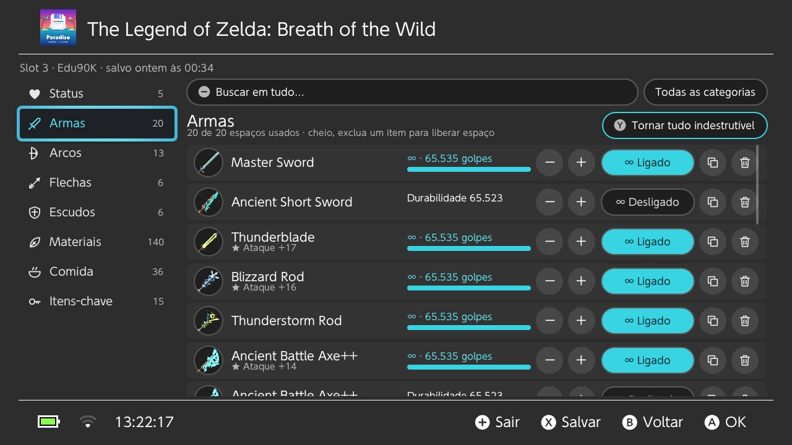
   Capturas de tela reais, tiradas no Switch.

> 🇧🇷 **O app é totalmente traduzido para o português do Brasil.** Ele segue o idioma do seu console, ou você escolhe em **Configurações → Idioma**.

---

## Conteúdo

- [O que ele faz](#o-que-ele-faz)
- [Jogos com editor](#jogos-com-editor)
- [Capturas de tela](#capturas-de-tela)
- [Instalação](#instalação)
- [Atualizações](#atualizações)
- [Como usar](#como-usar)
- [Jogos sem editor próprio](#jogos-sem-editor-próprio)
- [Backups e restauração](#backups-e-restauração)
- [Ícones reais dos jogos (Zelda)](#ícones-reais-dos-jogos-zelda)
- [Segurança](#segurança)
- [Perguntas frequentes](#perguntas-frequentes)
- [Bugs, ideias e pedidos de jogos](#bugs-ideias-e-pedidos-de-jogos)
- [Apoie o projeto](#apoie-o-projeto)
- [Créditos](#créditos)

## O que ele faz

- **Todos os jogos com save, num só lugar.** Seus jogos aparecem com os ícones, ordenados por jogado por último, salvo por último ou nome, e dá para buscar.
- **Todos os perfis e todos os slots.** Cada slot mostra data e hora do save, tempo de jogo, um resumo (corações, rupias, dinheiro…) e a própria captura de tela do jogo, quando ele tem uma.
- **Editores próprios** para jogos populares: dinheiro, itens, status, desbloqueios e, no Zelda, armas, arcos e escudos indestrutíveis.
- **Digite qualquer valor** pelo teclado numérico, ou use − / + / Máximo e **Tudo no máximo**.
- **Busca** dentro do save (numa categoria ou em todas), e listas longas são divididas em páginas.
- **Backups automáticos** antes de cada save que você edita, além de backups manuais com nome. Qualquer backup pode ser restaurado, e a restauração também pode ser desfeita.
- **Encontrar um valor** para jogos sem editor: procure um número que você vê no jogo e transforme ele num campo editável.
- **Atualizações pelo próprio app**, a partir desta página, com as novidades mostradas no console.
- **Totalmente traduzido para português (Brasil) e inglês.**

## Jogos com editor

| Jogo | O que dá para editar |
| --- | --- |
| **The Legend of Zelda: Breath of the Wild** | Rupias, corações, vigor, Mons, sementes Korok, materiais, comida, flechas, itens-chave; armas, arcos e escudos **indestrutíveis** (∞) um a um ou todos, copiar e excluir, espaços livres e bônus |
| **The Legend of Zelda: Tears of the Kingdom** | Rupias, corações, vigor, bateria zonai, materiais, comida, dispositivos zonai, itens-chave; armas, arcos e escudos **indestrutíveis** (∞), copiar e excluir, bônus e efeitos das comidas |
| **Pokémon Scarlet / Violet** | Dinheiro e os itens da mochila |
| **Pokémon Sword / Shield** | Dinheiro e os itens da mochila |
| **Pokémon Legends: Arceus** | Dinheiro e os itens da bolsa, do depósito, itens-chave e receitas |
| **Pokémon: Let's Go, Pikachu! / Eevee!** | Dinheiro e os itens da mochila, com os nomes |
| **Super Mario Odyssey** | Moedas; liberar roupas, chapéus, adesivos e lembranças |
| **Mario Kart 8 Deluxe** | Moedas, derrapagens, impulsos de salto e mini-turbos (a pontuação online não é tocada) |
| **Super Smash Bros. Ultimate** | Ouro, pontos de espírito, tíquetes, martelos, petiscos e itens das batalhas de espíritos |
| **Hyrule Warriors: Age of Calamity** | Rupias, mais de 160 materiais e o nível de cada personagem |
| **Super Kirby Clash** | Maçãs-gema, fragmentos e as duas missões heroicas escondidas |
| **Qualquer outro jogo** | Backup e restauração, mais [Encontrar um valor](#jogos-sem-editor-próprio) |

Quer outro jogo? Veja [pedidos de jogos](#bugs-ideias-e-pedidos-de-jogos).

## Capturas de tela

| | |
| --- | --- |
| 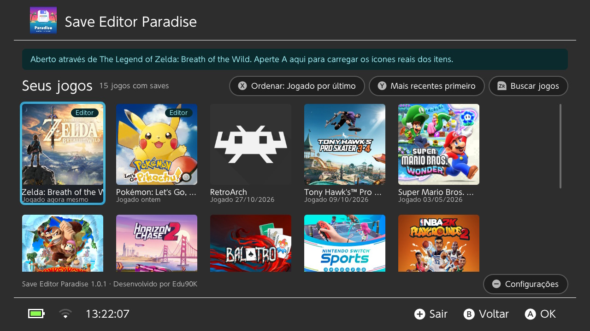 | 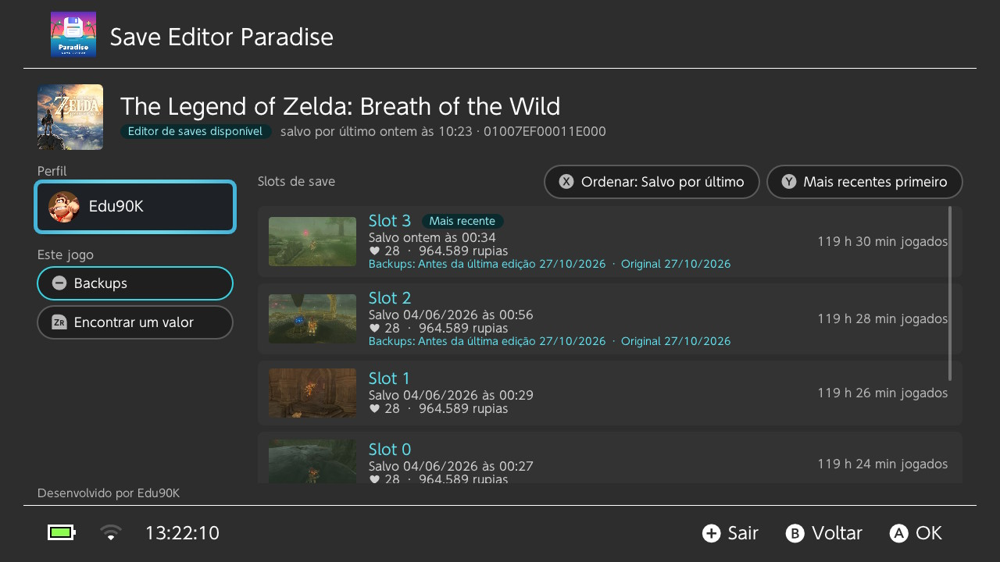 |
| Seus jogos, com os ícones reais | Slots de save com as capturas do próprio jogo |
| 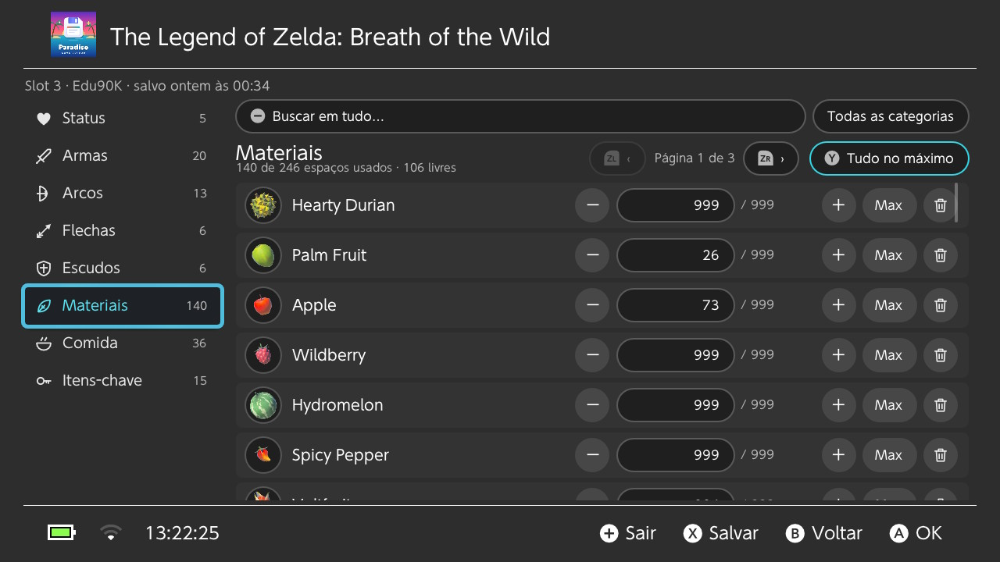 | 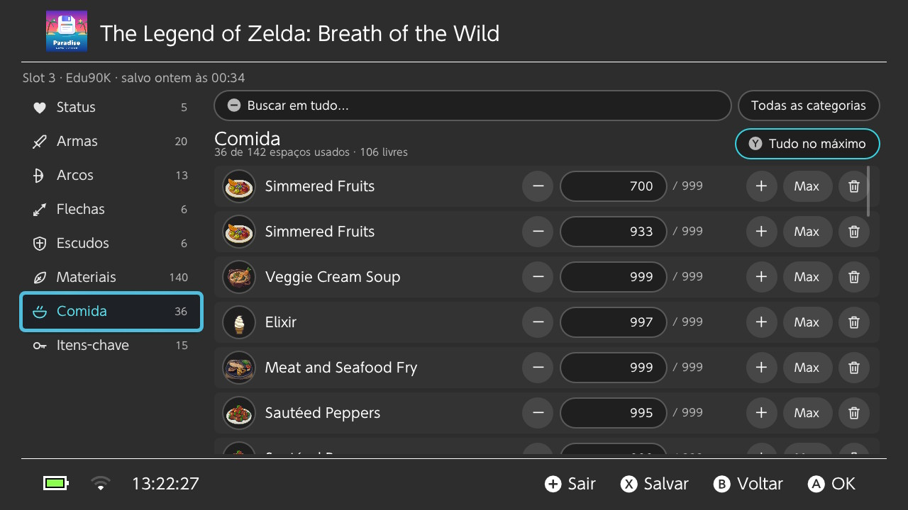 |
| Materiais, com os ícones reais e páginas | Comida, com quantidades que você digita |
| 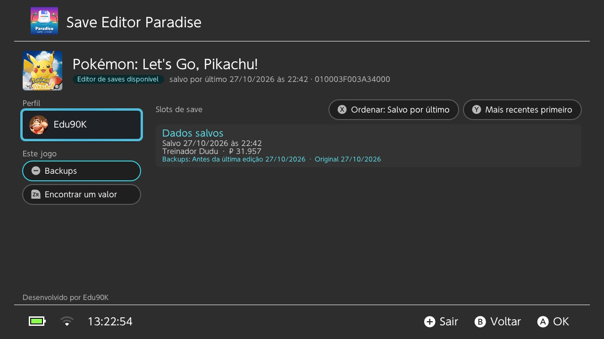 | 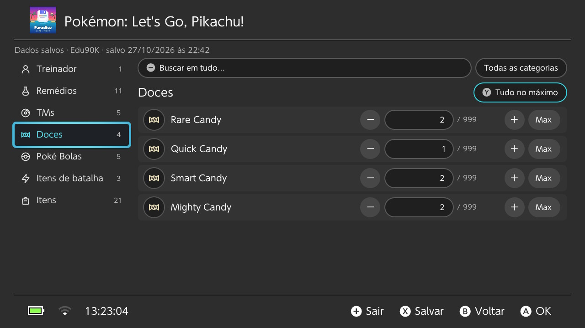 |
| Save de Pokémon: Let's Go, Pikachu! | Itens da mochila com os nomes |

## Instalação

**Você precisa** de um Nintendo Switch com o custom firmware [Atmosphère](https://github.com/Atmosphere-NX/Atmosphere) e o Homebrew Menu.

1. Baixe o **`save-editor-paradise.nro`** da [última versão](https://github.com/eduardo-santos/switch-save-editor-paradise-releases/releases/latest).
2. Copie para a pasta **`/switch/`** do cartão SD.
3. Abra o Homebrew Menu e inicie o **Save Editor Paradise**.

> **Dica:** abra o Homebrew Menu segurando **R** enquanto inicia qualquer jogo (não pelo Álbum). Assim o app tem toda a memória do console, o que ajuda com saves grandes e com o carregamento dos ícones reais.

## Atualizações

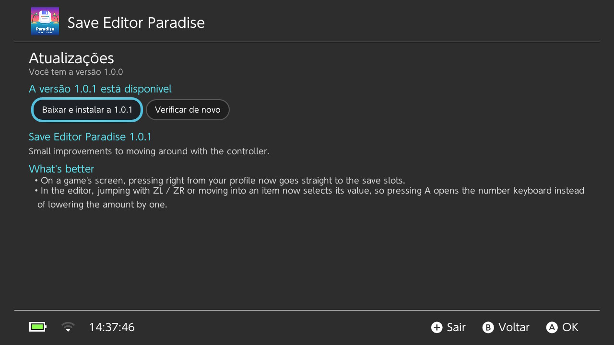

No app, abra **Configurações → Procurar atualizações agora**. Ele mostra as novidades, baixa a atualização, confere o arquivo e reinicia já na versão nova. A versão anterior fica guardada em `/switch/save-editor-paradise/previous.nro`, por garantia.

Com **Procurar atualizações ao abrir o app** ligado (o padrão), o app avisa quando sai uma versão nova. Você também pode simplesmente trocar o `.nro` no cartão SD.

Algumas atualizações são **obrigatórias** (o nome da versão diz "mandatory"), por exemplo quando uma versão antiga poderia estragar saves. Quando sai uma, o app pede para instalar antes de continuar. Seus saves, backups e configurações são mantidos.

## Como usar

### 1. Escolha um jogo

Jogos com editor próprio têm o selo **Editor**. Ordene com **X**, inverta a ordem com **Y** e busque com **ZR**. O **−** abre as Configurações.

### 2. Escolha um perfil e um slot

Cada slot mostra quando foi salvo, o tempo de jogo e um resumo. Os botões **Backups** e **Encontrar um valor** valem para o jogo inteiro.

> **Feche o jogo antes.** Um jogo aberto mantém o save bloqueado e apagaria suas mudanças. O app avisa quando um jogo ainda está aberto.

### 3. Edite

  
  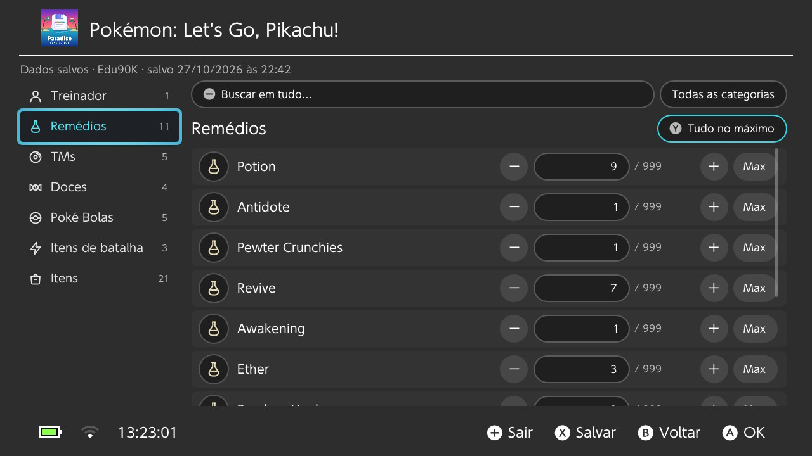

| Botão | Faz |
| --- | --- |
| **L / R** | Categoria anterior / próxima |
| **A** | Muda o valor selecionado (digite, ou use − / + / Máximo) |
| **Y** | Tudo no máximo (ou tudo indestrutível, ou liberar tudo) |
| **ZL / ZR** | Vai para o primeiro / último item; aperte de novo para a página anterior / próxima |
| **−** | Buscar |
| **X** | Salvar |
| **B** | Voltar (pergunta antes de descartar mudanças não salvas) |

Ao salvar, o app faz backup do slot primeiro, grava suas mudanças e diz onde ficou o backup.

> **Breath of the Wild:** depois de editar, abra o slot com **Carregar** no menu do jogo. **Continuar** pode abrir outro slot.

## Jogos sem editor próprio

### Encontrar um valor

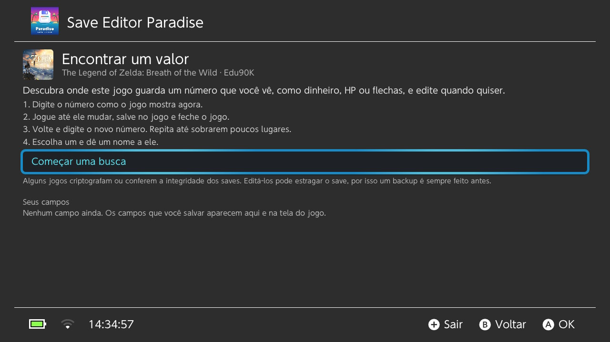

1. Na tela do jogo, escolha **Encontrar um valor** (ou aperte **ZR**).
2. Digite um número que você está vendo no jogo agora, como seu dinheiro.
3. Jogue até esse número mudar, salve no jogo e feche ele.
4. Volte e digite o número novo. Repita até sobrarem poucos lugares.
5. Escolha um, dê um nome (e um máximo), e ele vira um campo editável na tela desse jogo dali em diante.

Alguns jogos criptografam ou protegem seus saves com checksum. O Encontrar um valor não consegue mudar esses com segurança, e o backup automático permite desfazer se o jogo recusar um save editado.

### Backup e restauração

Todo jogo pode ter backup e restauração, com ou sem editor. Veja abaixo.

## Backups e restauração

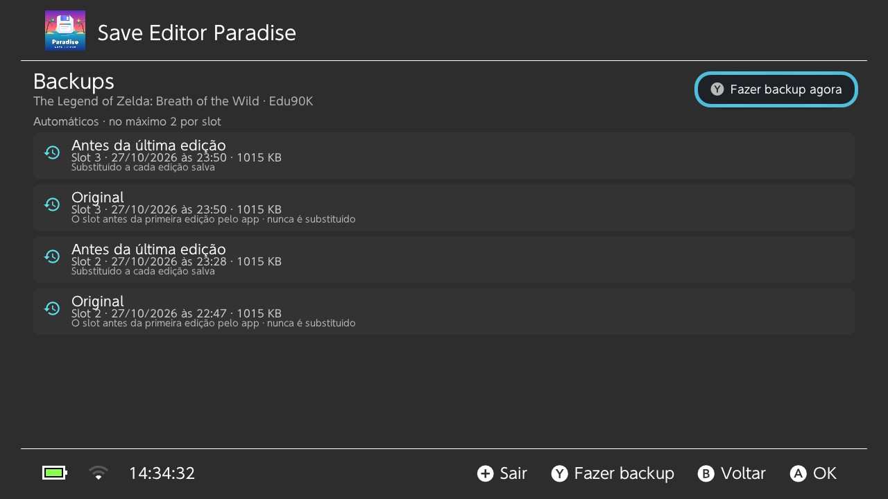

- **Automáticos:** antes de cada edição, o app guarda no máximo dois backups por slot: o **Original** (o slot da primeira vez que você editou, guardado para sempre) e o **Antes da última edição** (substituído a cada vez).
- **Manuais:** faça quantos quiser, com nome, na tela **Backups** (**−** na tela do jogo).
- **Restaure** qualquer um na mesma tela. A restauração faz backup do estado atual antes, então também dá para desfazer.

Tudo fica em `/switch/save-editor-paradise/backups/` no cartão SD.

## Ícones reais dos jogos (Zelda)

Em **Breath of the Wild** e **Tears of the Kingdom**, o app pode mostrar os ícones dos itens do próprio jogo em vez dos desenhos dele. Eles são lidos da sua cópia do jogo, uma única vez:

1. Feche o app e o jogo.
2. Na tela HOME, **segure R** e inicie o jogo. Continue segurando até o Homebrew Menu abrir.
3. Abra o Save Editor Paradise. Um aviso diz que ele foi aberto através do jogo: aperte **A** nele.
4. Espere um ou dois minutos e feche o app.

Os ícones ficam salvos no cartão SD, então isso só é preciso uma vez por jogo. O app também explica isso na tela do jogo (**Obter ícones reais**).

## Segurança

- **Use emuMMC e fique offline.** Saves editados junto com jogo online ou saves na nuvem trazem risco de banimento.
- **Toda edição tem backup antes**, e qualquer backup pode ser restaurado.
- O app nunca grava num save enquanto o jogo dele está aberto.
- Pokémon: só o dinheiro e a quantidade de itens são editados; seus Pokémon nunca são tocados.

## Perguntas frequentes

**Minha edição no Breath of the Wild não apareceu.** Abra o slot editado com **Carregar** em vez de **Continuar**.

**"Indestrutível" é infinito mesmo?** Ele coloca a maior durabilidade que o jogo aceita (Breath of the Wild) ou usa o próprio truque de bônus de durabilidade do jogo (Tears of the Kingdom). Na prática suas armas não quebram, mas itens que você pegar depois são normais até você editar eles também.

**O app travou.** Abra **Configurações → Relatório de diagnóstico** (ou aperte **ZL** na tela de jogos) e coloque uma foto dele num [relato de bug](https://github.com/eduardo-santos/switch-save-editor-paradise-releases/issues/new?template=bug_report.yml). Ele inclui os detalhes do último travamento e nenhum conteúdo dos seus saves.

**Onde ficam meus dados?** Em `/switch/save-editor-paradise/` no cartão SD: configurações, backups, ícones e os campos do Encontrar um valor. Dados de versões antigas (`/switch/switch-save-editor/`) são movidos para lá automaticamente.

**Como troco o idioma?** **Configurações → Idioma**: Sistema, English ou Português (Brasil). Reinicie o app para aplicar.

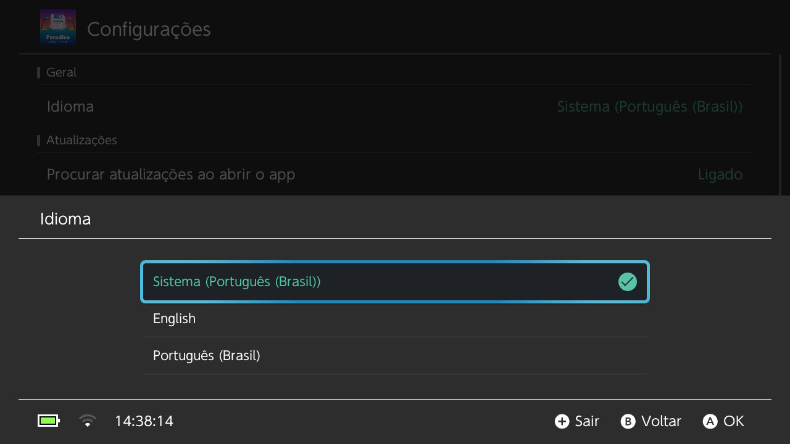

## Bugs, ideias e pedidos de jogos

Pode escrever em português, sem problema.

- 🐞 **Achou um bug?** [Relate aqui](https://github.com/eduardo-santos/switch-save-editor-paradise-releases/issues/new?template=bug_report.yml), de preferência com uma foto do relatório de diagnóstico.
- 💡 **Tem uma ideia ou melhoria?** [Sugira aqui](https://github.com/eduardo-santos/switch-save-editor-paradise-releases/issues/new?template=idea.yml), ou comece uma conversa nas [Discussions](https://github.com/eduardo-santos/switch-save-editor-paradise-releases/discussions).
- 🎮 **Quer outro jogo com editor?** [Peça aqui](https://github.com/eduardo-santos/switch-save-editor-paradise-releases/issues/new?template=game_request.yml).

## Apoie o projeto

O Save Editor Paradise é gratuito. Se ele te poupou horas de farm, você pode me pagar um café:

## Créditos

Desenvolvido por **Edu90K**.

O Save Editor Paradise se apoia no trabalho de outras pessoas:

- [Borealis](https://github.com/xfangfang/borealis), pela interface no estilo do Switch
- [marcrobledo/savegame-editors](https://github.com/marcrobledo/savegame-editors), pela estrutura dos saves de Zelda, Smash, Age of Calamity e Kirby
- [PKHeX](https://github.com/kwsch/PKHeX) (documentação do formato) e [PokeAPI](https://pokeapi.co) (nomes dos itens), para Pokémon
- A pesquisa de saves do [EdiZon](https://github.com/WerWolv/EdiZon_CheatsConfigsAndScripts), para Mario Kart 8 Deluxe e Super Mario Odyssey
- [Zstandard](https://github.com/facebook/zstd), [ARM astc-encoder](https://github.com/ARM-software/astc-encoder) e [bcdec](https://github.com/iOrange/bcdec), para ler os ícones dos jogos

Veja as licenças em [THIRD_PARTY_NOTICES.md](THIRD_PARTY_NOTICES.md).

Sem vínculo com a Nintendo, The Pokémon Company ou qualquer editora de jogos, nem aprovado por elas. Todos os nomes de jogos e marcas pertencem aos seus donos.
